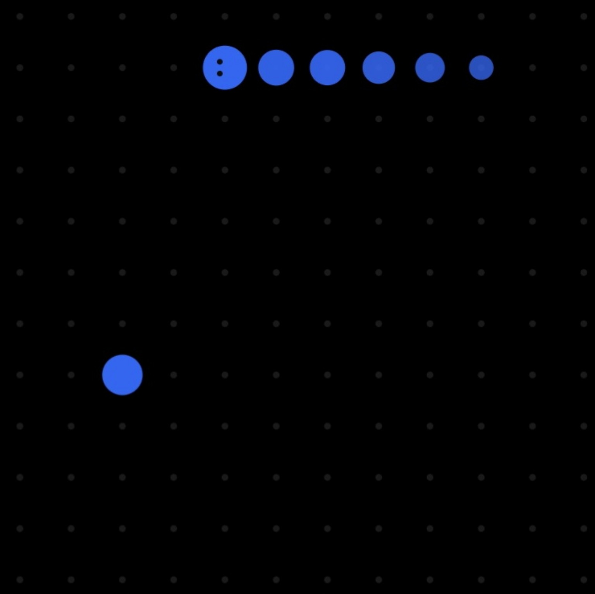

# Dot Snake

A minimalist, grid-based Snake game for the browser. Pure black board, a soft
dot grid, and a bright blue snake that tapers from its two-eyed head to its
tail. Plays on phones, tablets, laptops and desktops with touch buttons or the
keyboard.

**Play it:** https://dot-snake.vercel.app
**Source:** https://github.com/twishamp2024/dot-snake

<p align="center"></p>

## Features

- Snake on a 15 × 15 grid: eat the food to grow and avoid your own body.
- The edges wrap around: leave the board on one side and the snake slides back in on the opposite
  side, so the only way to lose is to run into yourself.
- Food only ever spawns on free cells; filling the whole board wins the game.
- Progressive difficulty: every food makes the snake a little faster, down to a per-difficulty floor.
  Choose **Easy**, **Normal** or **Hard** before a game; the HUD shows the current speed level.
- Live score plus a best score per difficulty, saved in the browser.
- Pause/resume and restart, from buttons or keys. The game pauses itself when you switch tabs or apps.
- Smooth motion: the game logic advances on a fixed tick while the canvas interpolates every
  frame between ticks, so the snake glides instead of jumping.
- Input buffering with a reversal guard: up to two quick turns are queued, and each one is checked
  against the turn before it, so a fast double-tap can never fold the snake back into itself.
- Crisp on high-DPI screens; the board resizes with the window and orientation.

## Controls

| Input | Action |
| --- | --- |
| <kbd>↑</kbd> / <kbd>W</kbd> | Move up |
| <kbd>↓</kbd> / <kbd>S</kbd> | Move down |
| <kbd>←</kbd> / <kbd>A</kbd> | Move left |
| <kbd>→</kbd> / <kbd>D</kbd> | Move right |
| <kbd>Space</kbd> | Pause / resume (also starts a new game) |
| <kbd>Enter</kbd> | Restart after game over |
| On-screen **UP / DOWN / LEFT / RIGHT** | Move (touch, mouse or pen) |

- Keys work as soon as the page loads; no need to click the board first.
- Arrow keys and Space never scroll the page while you play.
- Holding an on-screen button keeps its direction "armed": if the turn can't be taken yet
  (for example, two turns are already queued), it is applied on the next tick where it is legal.
- WASD uses physical key positions, so it works on AZERTY and other layouts too.

## Technology

- [Vite](https://vite.dev/) 8 for dev server and production bundling
- [React](https://react.dev/) 19 for the UI shell (HUD, overlay, buttons)
- [TypeScript](https://www.typescriptlang.org/) 7, strict mode
- HTML Canvas 2D for the board
- [Vitest](https://vitest.dev/) 5 for unit tests

No runtime dependencies besides React.

### Architecture

```
src/
  game/
    types.ts        Shared types (Point, Direction, GameState, …)
    engine.ts       Pure game rules: movement, turns, collisions, food, speed
    engine.test.ts  Unit tests for the rules
    renderer.ts     Canvas drawing (grid, snake, eyes, food, animations)
    controller.ts   Fixed-timestep loop, input buffering, best score; an external store for React
  input/
    keyboard.ts     Window-level keyboard bindings
  hooks/
    useGameController.ts  Creates the controller, binds keys, auto-pauses on blur
  components/       GameBoard (canvas + resize), Hud, Overlay, DirectionPad, Icons
  App.tsx, main.tsx, styles.css
```

The engine is framework-free: every function takes a state and returns a new one, which keeps the
rules easy to test. React only re-renders when the score, status or speed level changes; the
60 fps drawing happens directly on the canvas.

## Getting started

Requires Node.js 20.19+ (or 22.12+) and npm.

```bash
git clone https://github.com/twishamp2024/dot-snake.git
cd dot-snake
npm install
```

### Development

```bash
npm run dev        # start the Vite dev server at http://localhost:5173
npm test           # run the unit tests once
npm run test:watch # re-run tests on change
npm run typecheck  # TypeScript only
```

### Production build

```bash
npm run build      # type-check, then bundle to dist/
npm run preview    # serve the built dist/ locally
```

## Deployment

The site is deployed on [Vercel](https://vercel.com/) as a static Vite build. `vercel.json` pins the
settings:

- Framework preset: Vite
- Install command: `npm ci`
- Build command: `npm run build`
- Output directory: `dist`
- Long-lived cache headers for hashed files in `/assets`

Live URL: https://dot-snake.vercel.app

The repository is connected to the Vercel project through the Vercel GitHub app: every push to `main`
deploys to production automatically, and other branches and pull requests get preview deployments.

To deploy your own copy, import the GitHub repository in the Vercel dashboard (the settings above
are picked up automatically), or run `npx vercel --prod` from the project folder.

## Repository

https://github.com/twishamp2024/dot-snake
